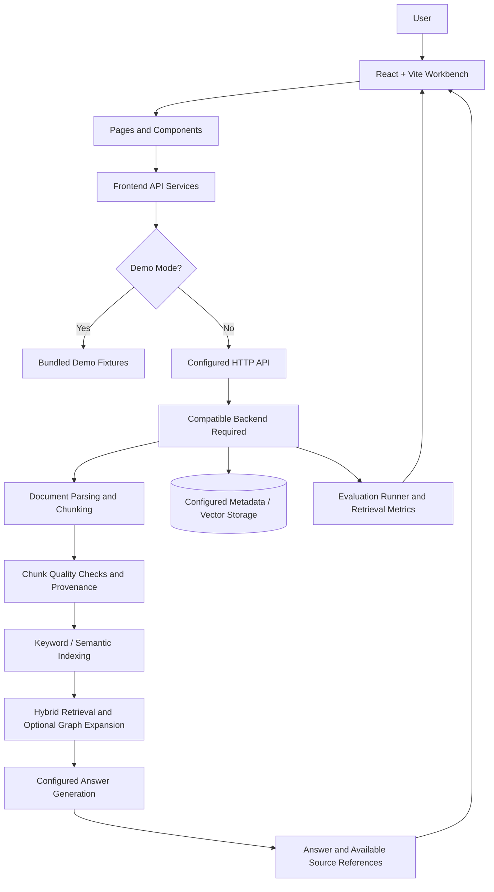

# SmartChunk

### Evidence-Aware Chunking and Retrieval for Scientific Documents

> **Don't just split documents. Validate every chunk. Trace every answer. Measure retrieval quality.**

SmartChunk is a scientific-document workbench for exploring document ingestion, chunk quality checks, source provenance, hybrid retrieval, context relationships, and comparative retrieval evaluation. It is designed around a practical RAG problem: splitting a research paper into arbitrary text windows can separate equations, tables, headings, citations, and the context needed to interpret them.

> **Repository scope:** This README is based on the available `GRAPHITE FRONTEND` project archive. That archive contains the React/Vite UI, API client contracts, a Node development backend, database migration files, and frontend test harnesses. It does **not** include a Python/FastAPI backend implementation. The UI's live-backend mode expects an API compatible with the documented contracts; use Demo Mode to explore the included fixtures without a separate backend.

## Table of Contents

- [Problem Statement](#problem-statement)
- [Our Solution](#our-solution)
- [Key Features and Implementation Status](#key-features-and-implementation-status)
- [How It Works](#how-it-works)
- [System Architecture](#system-architecture)
- [What Makes SmartChunk Different?](#what-makes-smartchunk-different)
- [Technology Stack](#technology-stack)
- [Repository Structure](#repository-structure)
- [Installation and Setup](#installation-and-setup)
- [Environment Variables](#environment-variables)
- [Usage Guide](#usage-guide)
- [Example Workflow](#example-workflow)
- [Evaluation and Testing](#evaluation-and-testing)
- [Limitations](#limitations)
- [Roadmap](#roadmap)
- [Contributing](#contributing)
- [License](#license)
- [Acknowledgements and Contact](#acknowledgements-and-contact)

## Problem Statement

Retrieval-Augmented Generation (RAG) gives a language model relevant passages from external documents before it generates an answer. The quality of that answer depends partly on whether the retrieval system can find the right evidence and preserve enough context to interpret it.

Scientific papers are more structured than ordinary prose. They may contain equations, tables, captions, citations, section hierarchies, and concepts that refer to one another. Basic fixed-size chunking can split an equation from its explanation, separate a table from its header, or detach a passage from its section heading. A retrieval system may then return a passage that appears relevant but does not contain enough evidence to answer the question well.

A similarity score alone does not establish that a chunk is complete, that a source can be traced, or that a retrieval strategy performs well on a defined evaluation set.

## Our Solution

SmartChunk brings several evidence-focused capabilities into one document-workbench experience:

1. **Chunk inspection and quality status** to help identify chunks that pass checks, need repair, require review, or should be excluded.
2. **Source provenance** using content fingerprints and document metadata, so content can be connected back to its origin when source details are available.
3. **Hybrid retrieval interfaces and API contracts** for keyword search, semantic retrieval, and optional graph-based context expansion.
4. **Evidence-grounded Q&A interfaces** that can display retrieved passages and citations when a compatible backend supplies them.
5. **Comparative evaluation tools** for inspecting chunking and retrieval strategies using established retrieval metrics.

The available frontend includes demo fixtures and a development API stub. A production-quality retrieval result depends on the backend, data, models, and evaluation corpus connected to the UI; the frontend alone does not establish that one chunking strategy is more accurate than another.

## Key Features and Implementation Status

| Capability | What it does | Status in the available project archive |
|---|---|---|
| Document workbench | Document listing, upload UI, and structural-block previews | UI and API client present; live ingestion requires a compatible backend |
| Chunk inspector | Browse chunk content, metadata, and diagnostics | UI, types, and API client present; live data depends on backend |
| Quality gate | Presents `PASS`, `REPAIR`, `REVIEW`, and `REJECT` states and repair-related views | UI and API contract present; backend validation/repair is not included in this archive |
| Source provenance and versioning | Displays version history, comparisons, hashes, and source metadata | UI, types, migration SQL, and test harness present; database-backed behavior requires a compatible backend |
| Hybrid retrieval and chat | API client and UI for source-grounded Q&A and evidence inspection | UI and API contract present; live retrieval/LLM execution requires a compatible backend |
| Context graph | Visualises relationships and offers context-expansion controls | UI, API client, and migration SQL present; live graph data requires a compatible backend |
| Benchmark dashboard | Compares strategies and displays retrieval metrics | UI, API client, migration SQL, and simulation-oriented tests present; valid empirical results require a real evaluation run and reviewed labels |
| Deduplication evaluation | Displays duplicate clusters and before/after evaluation views | UI, API client, migration SQL, and simulation-oriented tests present; production execution requires a compatible backend |
| Research agent | UI for multi-step research tasks and tool traces | UI and API client present; live task execution requires a compatible backend |
| Demo Mode | Uses bundled example fixtures for interface exploration | Included; demo data is illustrative, not a benchmark result |

**Important distinction:** The presence of a page, API client, migration, or test fixture does not by itself prove that the corresponding production backend workflow is deployed or operational.

## How It Works

The intended end-to-end workflow is:

1. **Document ingestion** — select a scientific document through the document interface.
2. **Parsing and preprocessing** — extract text and, where supported by the backend, preserve headings, tables, equations, page references, and other structural metadata.
3. **Chunking and quality validation** — create candidate chunks and evaluate them against configured quality checks.
4. **Indexing** — store searchable text, metadata, and embeddings in the configured retrieval infrastructure.
5. **Hybrid retrieval** — combine keyword and semantic retrieval; optionally expand context through graph relationships.
6. **Answer generation** — send retrieved evidence to a configured language model and return an answer with source references when available.
7. **Provenance and evaluation** — inspect source locations and compare retrieval strategies using a defined dataset and metrics.

The frontend supports the workflow through UI pages and service modules. Steps that require parsing, indexing, embeddings, a database, or an LLM must be provided by a compatible backend; they should not be assumed to run solely because the frontend is available.

## System Architecture



The diagram distinguishes the included frontend from backend services that must be supplied separately for live operation. The repository archive includes SQL migration files and a Docker Compose configuration for PostgreSQL with pgvector and Qdrant, but those files alone do not demonstrate that a production backend is connected to these services.

## What Makes SmartChunk Different?

SmartChunk is designed to make four questions easier to investigate in one place:

- **Is this chunk suitable for retrieval?** The quality-gate workflow makes chunk status and diagnostics visible.
- **Where did this evidence come from?** Provenance views are designed to connect chunks with document versions and source locations.
- **Can related evidence be found together?** The retrieval interface supports keyword, semantic, and optional graph-context workflows through its API contracts.
- **Does a strategy actually perform well?** The benchmark interface is designed to compare strategies with measurable retrieval metrics.

These are design goals and supported UI/API-contract areas, not a claim that SmartChunk has already outperformed existing systems. Comparative performance must be established with a documented dataset, valid relevance labels, repeatable runs, and reported results.

## Technology Stack

| Layer | Technology evidenced in the available archive | Notes |
|---|---|---|
| Frontend | React 18, TypeScript, Vite 6 | Main user interface and development server |
| Styling | Tailwind CSS 3, PostCSS | UI styling and build pipeline |
| Charts and icons | Recharts, Lucide React (with a local icon alias) | Dashboard visualisations and interface icons |
| Frontend API | Browser `fetch` through a shared API client | Configurable base URL, request timeout, and demo-mode preference |
| Development API | Node.js script (`dev-backend.cjs`) | Local development stub; not a substitute for a production scientific RAG backend |
| Database schema assets | SQL migrations; Docker Compose references PostgreSQL 16 with pgvector and Qdrant | Included configuration assets; live connectivity must be configured and verified |
| Backend integration target | FastAPI-compatible HTTP API described in integration documentation | Python backend source is not included in the inspected frontend archive |
| Embeddings and LLM | Configurable in the backend integration contract/environment template | The frontend archive does not establish which model is running in production |

## Repository Structure

The following is the main structure of the available frontend archive; generated build files and less relevant assets are omitted for readability.

```text
GRAPHITE FRONTEND/
├── .env.example
├── BACKEND_INTEGRATION.md
├── Dockerfile
├── docker-compose.yml
├── dev-backend.cjs
├── index.html
├── package.json
├── vite.config.ts
├── nginx.conf
├── schema/
│   └── migrations/
│       ├── 001_document_versioning.sql
│       ├── 002_context_dependency_graph.sql
│       ├── 003_comparative_benchmark.sql
│       ├── 004_deduplication_clusters.sql
│       └── combined_migrations.sql
├── scripts/
│   └── migrate.cjs
├── src/
│   ├── App.tsx
│   ├── main.tsx
│   ├── components/
│   │   ├── benchmarks/
│   │   ├── charts/
│   │   ├── chunks/
│   │   ├── config/
│   │   ├── deduplication/
│   │   ├── documents/
│   │   ├── graph/
│   │   ├── layout/
│   │   ├── retrieval/
│   │   └── ui/
│   ├── context/
│   ├── demo/
│   │   └── demoData.ts
│   ├── pages/
│   │   ├── OverviewPage.tsx
│   │   ├── DocumentsPage.tsx
│   │   ├── ChunkInspectorPage.tsx
│   │   ├── QualityGatePage.tsx
│   │   ├── BenchmarksPage.tsx
│   │   ├── KnowledgeGraphPage.tsx
│   │   ├── ChatPage.tsx
│   │   ├── ResearchAgentPage.tsx
│   │   └── SettingsPage.tsx
│   ├── services/
│   │   ├── apiClient.ts
│   │   ├── documentsApi.ts
│   │   ├── chunksApi.ts
│   │   ├── qualityApi.ts
│   │   ├── retrievalApi.ts
│   │   ├── chatApi.ts
│   │   ├── graphApi.ts
│   │   ├── benchmarksApi.ts
│   │   └── agentApi.ts
│   ├── styles/
│   └── types/
└── tests/
    ├── all_features_test.cjs
    ├── versioning_test.cjs
    ├── graph_dependency_test.cjs
    ├── benchmarks_test.cjs
    ├── structure_benchmark_test.cjs
    └── deduplication_test.cjs
```

## Installation and Setup

### Prerequisites

- Node.js and npm (Node.js 18 or newer is recommended by the existing project documentation).
- A compatible backend only if you want to use live API mode.
- Database services only if your separately configured backend requires them.

### 1. Get the frontend source

Open a terminal in the directory containing `package.json` (the frontend project root).

```bash
npm install
```

### 2. Configure the frontend

Create a local `.env` file from the template:

```bash
cp .env.example .env
```

On Windows PowerShell, use:

```powershell
Copy-Item .env.example .env
```

For a local UI preview, keep demo mode enabled. The default configuration points the API base URL at `http://localhost:8000` and enables demo mode unless overridden in the browser or environment.

### 3. Start the frontend

```bash
npm run dev
```

Vite is configured to listen on port `3000` and all host interfaces. Open:

- `http://localhost:3000`

### 4. Optional: start the included development API stub

In a second terminal, from the same frontend project root:

```bash
npm run backend
```

The Node development server defaults to port `8000`. It is intended for local development and API/UI integration checks; do not treat it as proof that a full scientific RAG backend, model provider, or production database is configured.

### 5. Production build

```bash
npm run build
npm run preview
```

The Dockerfile also defines a multi-stage frontend build served by Nginx. The included Compose file starts PostgreSQL/pgvector, Qdrant, and the frontend; it does not include a Python/FastAPI service in the inspected archive.

## Environment Variables

The following frontend variables are read by the frontend source:

| Variable | Default / example | Purpose |
|---|---|---|
| `VITE_API_BASE_URL` | `http://localhost:8000` | Base URL used by the shared frontend API client |
| `VITE_DEFAULT_DEMO_MODE` | `true` in `.env.example` | Enables demo mode by default unless a browser preference overrides it |

A safe minimal `.env.example` for the frontend is:

```dotenv
# Frontend only; no secrets required for Demo Mode
VITE_API_BASE_URL=http://localhost:8000
VITE_DEFAULT_DEMO_MODE=true
```

The existing `.env.example` also lists PostgreSQL, Qdrant, embedding, and LLM settings for a wider backend setup. Those values are not read by the frontend API client itself. Configure them only for a backend that actually supports them, and never commit real API keys or passwords. The checked-in template uses placeholder values rather than a real secret.

## Usage Guide

### Explore the interface in Demo Mode

1. Start the frontend using `npm run dev`.
2. Keep `VITE_DEFAULT_DEMO_MODE=true`, or enable Demo Mode using the app's demo/live control.
3. Open the overview, documents, chunk inspector, quality gate, benchmarks, graph, chat, and research-agent pages.
4. Use the bundled sample fixtures to explore the interface and understand the intended workflow.

Demo content is illustrative. It should not be cited as evidence of production retrieval quality or as a real benchmark result.

### Connect a live backend

1. Start a compatible backend separately.
2. Set `VITE_API_BASE_URL` to its reachable base URL.
3. Set `VITE_DEFAULT_DEMO_MODE=false` and disable any saved browser Demo Mode preference.
4. Ensure the backend implements the request and response contracts documented in `BACKEND_INTEGRATION.md`.
5. Verify the health endpoint and each workflow before using live mode.

The frontend includes API service modules for documents, chunks, quality checks, retrieval, chat, graph data, benchmarks, exports, configuration, and research-agent tasks. Availability in the UI depends on the backend implementing the corresponding endpoints.

## Example Workflow

**Illustrative example only — not a verified SmartChunk output or benchmark.**

1. Upload a paper about transformer attention through a compatible live backend.
2. Inspect the extracted section and its attention equation in the chunk inspector.
3. Review the chunk's quality status and available source metadata.
4. Ask: *“Why is the dot product scaled by the square root of the key dimension in scaled dot-product attention?”*
5. Inspect the retrieved passages and source references returned by the backend.
6. Run an evaluation against a labelled query set and compare retrieval strategies using Recall@K, MRR, and nDCG.

The answer and retrieved evidence depend on the actual document parser, index, retrieval implementation, model configuration, and evaluation data connected to the application.

## Evaluation and Testing

### Automated test command

Run the included test harnesses from the frontend project root:

```bash
npm test
```

The master runner invokes five Node.js suites covering:

- Version-aware evidence and provenance
- Context dependency graph and multi-hop traversal
- Comparative benchmarks
- Structure-aware document benchmarks
- Deduplication and before/after evaluation

**Verification performed for this README:** `npm test` was run against the available frontend archive on Node.js `v22.16.0`. The runner reported **5 suites passed, 0 suites failed**. The individual suites reported 7, 7, 6, 6, and 7 checks passed respectively.

These tests inspect project files, types, API-service contracts, UI integration, and algorithm simulations. They are not an end-to-end test of a production Python backend, a live database, external model calls, or a curated scientific retrieval benchmark. Passing these tests does not establish that SmartChunk outperforms baseline chunking methods.

### Retrieval metrics

When evaluated against a labelled query set, the project is designed to use standard metrics such as:

- **Recall@K:** Whether relevant evidence appears within the top K retrieved results.
- **MRR (Mean Reciprocal Rank):** How highly the first relevant result is ranked across queries.
- **nDCG (normalized Discounted Cumulative Gain):** How well results are ranked when relevance levels are taken into account.

Report dataset provenance, query count, relevance-labeling method, retrieval settings, repeated-run policy, latency, and metric values alongside any future benchmark claim. No verified comparative performance figures are reported here.

## Limitations

- **Backend dependency:** The available archive contains the frontend, development stub, and integration contract, but not the production Python/FastAPI implementation.
- **Parsing quality:** Scientific PDFs can contain scanned pages, complex layouts, tables, and mathematical notation that text extraction may not preserve correctly.
- **Evidence quality:** A chunk may pass configured checks and still be incomplete or irrelevant to a particular question.
- **Retrieval failures:** Keyword and semantic search can miss relevant passages or return distractors; graph expansion can add irrelevant context if relationships are poor.
- **LLM hallucinations:** Source citations and provenance help inspection but do not guarantee that a generated answer is correct or fully supported.
- **Benchmark validity:** Reliable comparisons require an appropriate dataset, human-reviewed relevance labels, repeatable settings, and transparent reporting.
- **Latency and external services:** Live performance depends on the configured database, embedding model, LLM provider, network, and document size.
- **Demo data:** Sample fixtures and simulation-based tests are useful for interface development, not substitutes for real corpus evaluation.

## Roadmap

### Present in the available frontend archive

- React-based document and chunk workbench
- Quality-gate, provenance/versioning, graph, chat, research-agent, and benchmark interfaces
- Shared API client and Demo Mode fixtures
- Database migration assets and local development API stub
- Automated structural and simulation-oriented test suites

### Future work / validation priorities

- Connect and verify a production backend for every live workflow
- Validate parsing and structure preservation on diverse scientific PDFs
- Build an approved benchmark corpus with human-reviewed relevance labels
- Publish repeatable comparisons against fixed-size and structure-aware baselines
- Evaluate answer grounding, citation correctness, latency, and failure cases
- Add deployment hardening, authentication, authorization, monitoring, and operational documentation as required

## Contributing

Contributions are welcome. Before opening a pull request:

1. Create a focused branch for your change.
2. Keep UI changes, API contract changes, and backend changes clearly separated.
3. Update types, service contracts, and tests when API behaviour changes.
4. Run `npm test` and `npm run build` where dependencies are available.
5. Document any new environment variables without committing secrets.
6. Describe what was verified and clearly label mock or simulated behaviour.

## License

No project license was identified in the inspected archive. **A license has not yet been specified.** Until a license is added, reuse and redistribution permissions should not be assumed.

## Acknowledgements and Contact

SmartChunk is associated with the Graphite 26 / Problem Statement 8 project context described in the available project files. No verified public project website, support email, or maintainer contact was found in the inspected archive.

For project questions, open an issue in the repository where SmartChunk is maintained once issue tracking and maintainer details are confirmed.
